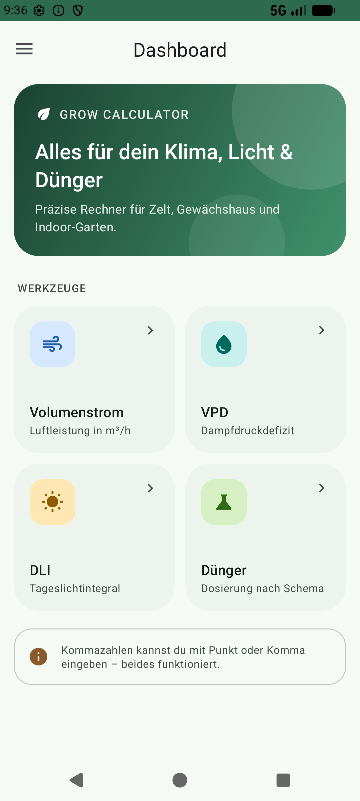
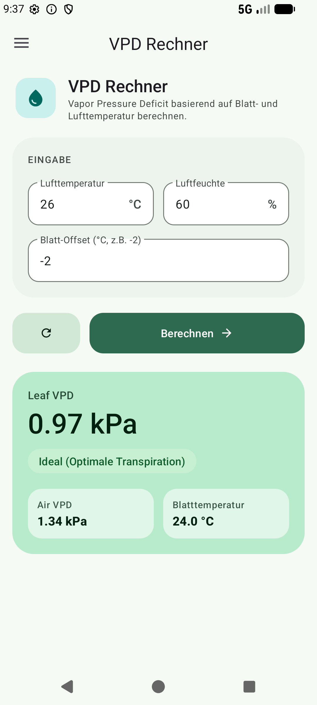

# GrowCalc 🌱

🌐 **Projektseite:** https://thedude1996.github.io/GrowCalc/

**GrowCalc** (in der App: *Grow Calculator*) ist eine Android-App mit Rechnern für den Indoor-Anbau: Lüftung, Klima, Licht und Düngung – übersichtlich, offline und ohne Werbung.

<p align="center">
  
  &nbsp;&nbsp;
  
</p>

## Funktionen

| Werkzeug | Was es berechnet |
|---|---|
| **Volumenstromrechner** | Luftleistung in m³/h aus Rohrdurchmesser (125–300 mm) und Strömungsgeschwindigkeit |
| **VPD-Rechner** | Dampfdruckdefizit (Luft und Blatt) aus Lufttemperatur, rel. Feuchte und Blatt-Offset, mit farbiger Bewertung |
| **DLI-Rechner** | Daily Light Integral aus PPFD und Beleuchtungsdauer, mit Schnellwahl (12/16/18/20/24 h) |
| **Dosierrechner (Dünger)** | Nährstoffmengen nach Herstellerschema (Green House Feeding, Athena, Advanced Nutrients) inkl. Ca:Mg-Korrektur anhand der Wasseranalyse |

Weitere Merkmale:

- Material-3-Design mit eigenem Farbschema und **Dark Mode**
- Eingaben mit Punkt *oder* Komma
- Farbcodierte Ergebnisse (ideal / niedrig / hoch / kritisch)
- Komplett offline, keine Berechtigungen nötig

Die verwendeten Formeln sind in [docs/BERECHNUNGEN.md](docs/BERECHNUNGEN.md) beschrieben.

## Voraussetzungen

- Android Studio (aktuelle Version) mit JDK 17+ (das mitgelieferte JBR reicht)
- Android SDK 36
- Gerät oder Emulator mit **Android 7.0 (API 24)** oder neuer

## Bauen & Starten

```bash
# Debug-APK bauen
./gradlew assembleDebug          # Windows: gradlew.bat assembleDebug

# Auf verbundenem Gerät/Emulator installieren
./gradlew installDebug

# Unit-Tests ausführen
./gradlew testDebugUnitTest
```

Die APK liegt danach unter `app/build/outputs/apk/debug/app-debug.apk`.

Alternativ: Projekt in Android Studio öffnen und auf **Run ▶** klicken.

## Projektstruktur

```
app/src/main/
├── java/com/example/volumenstromrechner/
│   ├── MainActivity.kt          # Navigation (Drawer + Fragmente)
│   ├── calculation/             # Reine Rechenlogik (ohne Android-Abhängigkeiten, unit-getestet)
│   ├── fragments/               # Ein Fragment pro Rechner + Dashboard
│   ├── model/                   # Datenmodelle & Düngeschemata der Hersteller
│   ├── viewmodel/               # NutrientViewModel (Zustand des Dosierrechners)
│   └── ui/                      # UI-Hilfen (farbige Status-Labels)
└── res/                         # Layouts, Farben (inkl. values-night), Icons, Strings
```

Mehr Details: [docs/ARCHITEKTUR.md](docs/ARCHITEKTUR.md)

## Dokumentation

- [Berechnungen & Formeln](docs/BERECHNUNGEN.md)
- [Architektur](docs/ARCHITEKTUR.md)
- [Mitwirken](CONTRIBUTING.md)
- [Änderungsprotokoll](CHANGELOG.md)

## Lizenz

GrowCalc ist freie Software unter der [GNU General Public License v3.0](LICENSE). Du darfst die App nutzen, verändern und weitergeben – abgeleitete Werke müssen ebenfalls unter der GPL-3.0 veröffentlicht werden.

## Haftungsausschluss

Die Ergebnisse sind Richtwerte. Düngeschemata stammen aus Herstellerangaben und können sich ändern – im Zweifel gilt immer die aktuelle Angabe des Herstellers. Die genannten Marken gehören ihren jeweiligen Inhabern; dieses Projekt steht in keiner Verbindung zu ihnen.
